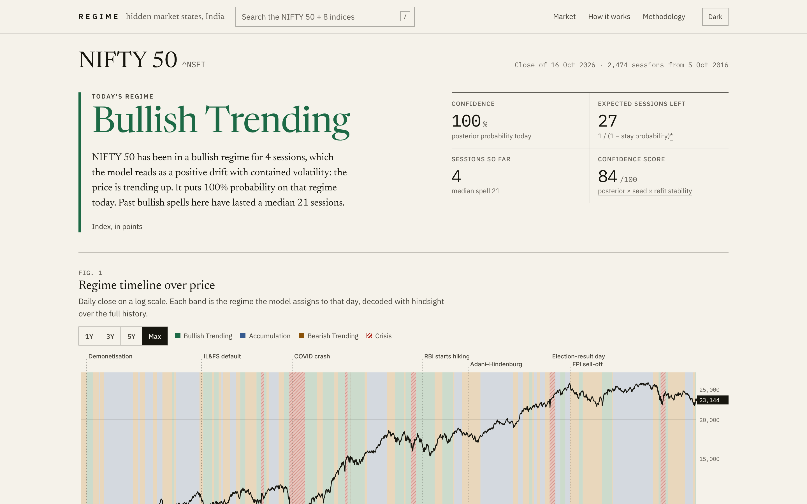

# REGIME

**Hidden market regimes for the NIFTY 50.** A 4-state Gaussian hidden Markov model fitted to each stock's own ten-year history classifies every trading day as Bullish Trending, Accumulation, Bearish Trending or Crisis. The site shows today's regime, how the stock got there, how much to trust the label, and what trading on it would have earned after real costs.

It is a fully static site. Every number is precomputed by a weekly job and served as plain files; there is no backend to wait for.


### [Live site → regime-omega.vercel.app](https://regime-omega.vercel.app)



## What's covered

**Only NIFTY 50 stocks are covered.** Every stock gets a full multi-start model fit, walk-forward refits and robustness checks, and keeping to the 50 largest, most liquid names keeps that complete and refreshed every week.

- **50 stocks**: NSE's official NIFTY 50 constituents. Cap bands and ranks come from AMFI's average market-cap list (31 Dec 2025 list), sectors from NSE's industry classification.
- **8 indices**: NIFTY 50, SENSEX, NIFTY Bank, NIFTY Next 50, NIFTY 500, NIFTY Midcap 50, NIFTY IT and NIFTY Pharma.
- **9 more sector indices** are tried every week but excluded, because Yahoo Finance has only a day or two of history for them. The methodology page lists each exclusion with its reason, and they come back automatically if the history appears.

Search covers exactly this universe and says so when a query misses.

## The site

| Page | What it shows |
|---|---|
| **Market** `/` | How many of the 50 are in each regime today, all 8 indices, weekly breadth over ten years (by sector too), and every stock on a sector map or a sortable table. |
| **Stock** `/stock/RELIANCE` | Today's regime and confidence, then the regime timeline over price and posterior ribbon, then the evidence: regime statistics, a calendar heatmap, a transition explorer that lists every historical switch, forward returns, crisis early warning, robustness checks, the backtest, and the fitted model. |
| **How it works** `/how-it-works` | "How an HMM sees the market": a step-by-step explainer on real NIFTY 50 data. The forward filter runs in the browser, so you can change how sticky the model is and watch the regimes respond. |
| **Methodology** `/methodology` | The universe, model, robustness definitions, full cost schedule, overfitting statistics, data refresh, exclusions and limits. |

URLs are shareable: `/stock/RELIANCE?range=5Y&at=2020-03-23` opens the five-year view with the cursor on the COVID crash, and `/?view=table&sort=posterior` restores the table sort.

Every chart is drawn by hand on Canvas (no chart library), works from the keyboard (← → move a session, PgUp/PgDn a month), and has a text readout. Every page has designed loading, not-covered, offline and stale-data states. Pages are checked with axe-core for WCAG AA in light and dark themes on desktop and mobile; the screenshots in [`screenshots/`](screenshots) cover every page and state.

## The model

- **Features** (daily, standardised): log return, 5- and 20-session volatility, volume z-score, 10-session momentum.
- **Fit**: 4-state Gaussian HMM with full covariances (hmmlearn), from five random starts plus a warm start from last week's parameters; the highest log-likelihood wins.
- **Labels**: the highest-volatility state is Crisis, the quietest Accumulation, and the other two split by drift into Bullish and Bearish. The same rule everywhere means a regime means the same kind of market on every page.
- **Walk-forward**: refit every 126 sessions on data up to that point (after 504 sessions of training) and label the next stretch with the forward filter, so nothing looks ahead.

## How much to trust a label

Each stock page reports:

- **Seed stability**: how often other random starts agree with the winning fit, day by day.
- **Refit stability**: how often walk-forward models fitted on less history agree with the full-history labels.
- **BIC over 2–6 states**: which number of states the information criterion prefers. It often prefers more than four, and the page says so rather than hiding it.
- **Confidence score**: 100 × the geometric mean of today's posterior, seed stability and refit stability.

## The backtest, honestly

The strategy holds 100% in Bullish, 50% in Accumulation and cash otherwise. A signal at the close fills at the **next open**. Every trade pays **Zerodha equity-delivery charges** (STT, exchange and SEBI fees, stamp duty, GST and the DP charge; schedule as of 18 Oct 2026) plus assumed slippage by cap band. Six variants are evaluated per ticker, and results are reported with the **probabilistic Sharpe ratio against buy-and-hold** and the **Deflated Sharpe Ratio** (Bailey and López de Prado).

The headline view is walk-forward. In the current data, the strategy beat buy-and-hold's CAGR on **none** of the 50 stocks after costs, and had a shallower maximum drawdown on 46 of them. For the NIFTY 50 index: 3.4% a year against 10.7%, with a worst drawdown of −20% against −38% and 1.6% a year lost to costs. The site shows this as it is. Read REGIME as a description of market state, not a trading system.

## Data and the weekly refresh

`.github/workflows/refresh-data.yml` runs every Saturday at 07:47 IST, on any push to `main` that touches the model or pipeline, and on demand. It works in four steps:

1. Rebuild the universe from the current NIFTY 50 list and the newest AMFI list. If that fails, keep the committed one.
2. Fit every ticker across two parallel shards. Prices are fetched in batches with retries and exponential backoff. A failing ticker is logged and skipped, never fatal.
3. Merge the shards. A ticker that failed keeps last week's file, marked with its own date.
4. Validate: at least 45 of 50 stocks covered, every file under 50 KB and consistent with the index. Only then does it commit the data, as `github-actions[bot]`. If validation fails, nothing is committed and the site keeps serving the last good data. Every page shows a notice once the data is more than ten days old.

A full run takes about three minutes on four cores. Per-ticker files average about 34 KB (about 2 MB for all 58). Because every file gains a week of data, a refresh rewrites all of them: expect roughly 1 MB of compressed repository growth a week. Successive runs are stable: re-running on the same data relabelled 0.1% of days and changed no current regime.

## Running it locally

```bash
python -m venv .venv && . .venv/bin/activate
pip install -r requirements-dev.txt

python scripts/serve.py                 # http://127.0.0.1:8050, same routes as production
python scripts/precompute.py --workers 4                    # refresh all data (~3 min, needs network)
python scripts/precompute.py --tickers RELIANCE,NIFTY50     # just a few
python scripts/precompute.py --synthetic --limit 20 --out /tmp/regime-data   # offline, synthetic
python scripts/validate_data.py --data static/data
```

Tests run offline: the Python suite blocks the network and uses synthetic data with known regimes.

```bash
pytest -q            # 90 tests: features, model, robustness, costs, backtest, encoding, universe, pipeline, site checks
npm install && npm test             # 15 tests: JS decoders and forward filter against Python output, formatting
npm run screenshots  # every page and state, desktop and mobile, with an axe-core accessibility pass
```

## Deploying

The site is the `static/` folder, with no build step. On Vercel, set the project's root directory to `static/`; `static/vercel.json` provides clean URLs, the `/stock/:slug` route and cache headers. The weekly workflow commits new data to `main`, which redeploys the site.

Earlier versions used a separate API on Render for live fits. Nothing uses it any more, so that service can be shut down.

## Project layout

```
regime/             model, robustness, costs, backtest, analytics, encoding, universe, pipeline
scripts/            precompute, universe builder, validator, local server, screenshots
data/universe.csv   the committed universe snapshot
static/             the site: HTML, css/, js/ (native ES modules), fonts/, data/
tests/              pytest suite and tests/js (node --test)
docs/               design-system.md
screenshots/        every page and state, plus the hero image above
```

## Limits

The regimes summarise past returns, volatility and volume for each stock separately; the same label can mean somewhat different conditions on two stocks. Transition probabilities are ten-year averages. Timeline bands and breadth use hindsight (Viterbi over the full history); only the walk-forward backtest and today's call avoid it. Prices come from a free data source.

**Research, not investment advice.**

## License

MIT. See [LICENSE](LICENSE). Fonts (Newsreader, IBM Plex) are under the SIL Open Font License; see `static/fonts/`.
